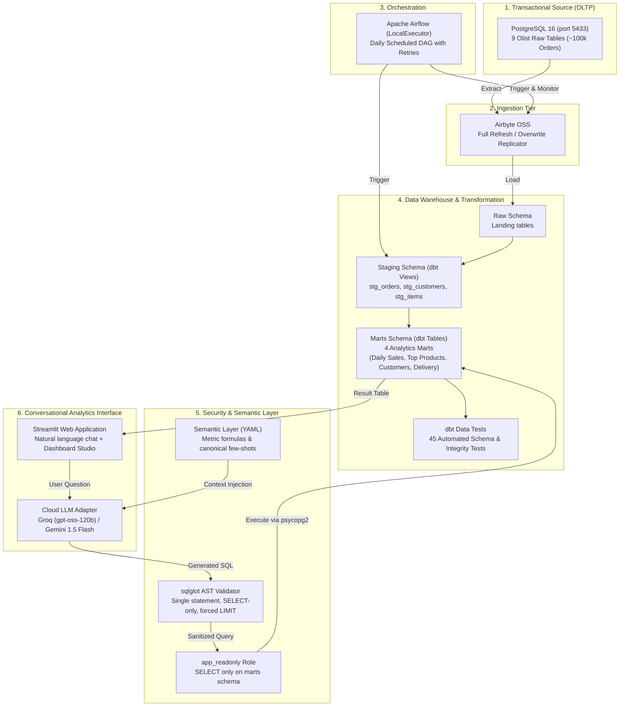
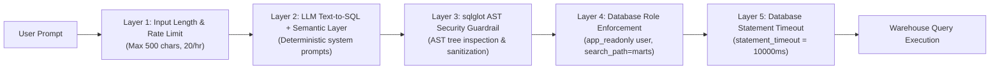

# 🏗️ NexusBI System Architecture & Technical Design

NexusBI is an end-to-end modern data engineering and conversational business intelligence platform built by a 3rd-year computer engineering student. It translates natural language business questions into verified SQL queries over 100,000 real-world Brazilian E-Commerce (Olist) transactions.

---

## 📐 End-to-End Pipeline Overview

---

## 🔍 Detailed Component Breakdown

### 1. Source Database (OLTP)
- **Engine**: PostgreSQL 16 running in a local Docker container (`olist-postgres`, port `5433`).
- **Dataset**: Brazilian E-Commerce Public Dataset by Olist (9 relational tables: `orders`, `order_items`, `order_payments`, `order_reviews`, `customers`, `geolocation`, `products`, `sellers`, `product_category_name_translation`).
- **Characteristics**: Normalized transactional schema optimized for row-level writes (OLTP).

### 2. Ingestion Tier (Airbyte OSS)
- **Engine**: Airbyte Open Source running on Kubernetes/Docker.
- **Strategy**: Extracts records from the source PostgreSQL database and writes them into the `raw` schema of the analytical warehouse.
- **Mode**: Full Refresh Overwrite, replicating operational tables without mutating transactional state.

### 3. Orchestration Engine (Apache Airflow)
- **Engine**: Apache Airflow 2.8+ using `LocalExecutor`.
- **DAG**: `olist_daily_pipeline` running on a daily schedule (`@daily`).
- **Task Graph**:
  1. `wait_for_source_db`: Pings the source PostgreSQL instance.
  2. `trigger_airbyte_sync`: Calls the Airbyte API to trigger and poll connector synchronization.
  3. `dbt_run_staging`: Builds dbt staging views cleaning types, timestamps, and column names.
  4. `dbt_run_marts`: Materializes the 4 analytical data marts (including incremental loading).
  5. `dbt_test`: Executes 45 data quality assertions.

### 4. Transformation & Data Modeling (dbt Core)
Data modeling follows dimensional design principles divided into two distinct layers:

#### A. Staging Layer (`staging` schema - Views)
Light transformations that do not duplicate storage:
- `stg_orders`: Standardizes timestamp fields, cleans order statuses, and filters invalid records.
- `stg_order_items`: Normalizes item sequence IDs, prices, and freight amounts.
- `stg_customers`: Deduplicates customer identities and normalizes Brazilian state codes.
- `stg_products`: Joins product dimension with English category name translations.
- `stg_order_payments`: Aggregates split tender payments by order.

#### B. Marts Layer (`marts` schema - Tables)
Aggregated dimensional models designed for fast analytical queries:
- `mart_daily_sales`: Daily grain table with sales date, order volume, items sold, gross revenue, freight charges, and average order value (AOV). Uses **incremental materialization** with a 3-day lookback window.
- `mart_top_products`: Product and category leaderboard with units sold, gross merchandise revenue, and dense ranks.
- `mart_customer_summary`: Customer lifetime summary (LTV, repeat buyer status, first/last purchase timestamps, city, and state).
- `mart_delivery_performance`: Monthly logistics fulfillment tracking actual delivery days against promised estimated delivery dates and late delivery rates.

#### C. Data Quality Assurance
- **45 Automated dbt Tests** run against the warehouse:
  - `unique` and `not_null` assertions on all primary keys and critical metrics.
  - Foreign key `relationships` tests verifying integrity across orders, customers, and items.
  - `accepted_values` checks on operational order statuses (`delivered`, `shipped`, `canceled`, etc.).
  - Range and domain validation on financial metrics (revenue and freight non-negative).

---

## 🛡️ Security & Guardrail Architecture

Allowing a language model to interact with a production warehouse introduces security risks, including prompt injection, SQL injection, denial-of-service, and unauthorized data exfiltration.

NexusBI implements a five-layer defense-in-depth model:

1. **Input Length & Rate Limiting**: Caps user prompts to 500 characters and enforces an hourly rate limit (default: 20 queries/hour/session).
2. **Abstract Syntax Tree (AST) Validation (`sqlglot`)**:
   - Parses incoming SQL into an AST before sending to the database.
   - Enforces single statement execution (strictly blocks `;` semicolon chaining).
   - Allows only `exp.Select` statements (blocks `DROP`, `ALTER`, `CREATE`, `INSERT`, `UPDATE`, `DELETE`, `TRUNCATE`, `GRANT`, `SELECT ... INTO`, and `FOR UPDATE`).
   - Restricts all physical table access to the 4 approved marts (`mart_daily_sales`, `mart_top_products`, `mart_customer_summary`, `mart_delivery_performance`).
   - Automatically injects `LIMIT 1000` to prevent memory exhaustion.
   - Blocks dangerous PostgreSQL functions (`pg_sleep`, `pg_read_file`, `dblink`, `lo_export`, `set_config`, and all `pg_*` catalogs).
3. **Database-Level Least Privilege**:
   - Web application connects exclusively via `app_readonly`.
   - `app_readonly` has `USAGE` only on the `marts` schema and `SELECT` only on the 4 marts tables.
   - Cannot read `raw` or `staging`, and has no write privileges anywhere.
4. **Server-Side Statement Timeout**:
   - `statement_timeout = 10000` (10 seconds) enforced directly on the PostgreSQL connection session. Any query taking longer than 10 seconds is killed by the database engine.

---

## 💡 Architectural Decisions & Trade-Offs

| Decision | Alternative Considered | Why Chosen |
| :--- | :--- | :--- |
| **ELT via dbt** | Traditional Python ETL script | Separates data loading from transformation. Enables version-controlled SQL models, automated testing, and lineage documentation directly inside the warehouse. |
| **sqlglot AST Parser** | Regex / Keyword Blacklisting | Regex string matching is easily bypassed by SQL comments (`/* */`), whitespace, subqueries, and casing tricks. AST parsing analyzes the actual syntax tree representation deterministically. |
| **Decoupled Serving Layer** | Ingestion pipeline running in cloud | Heavy data ingestion (Airbyte, Airflow, raw tables) runs locally on Docker for free. Only the lightweight curated marts (~10 MB) are served in the cloud, keeping cloud hosting costs at zero. |
| **Cloud LLM (Groq / Gemini)** | Local Ollama LLM | Local LLM execution requires 6-8 GB of host RAM, causing memory errors on developer laptops. Free cloud LLM APIs generate SQL in ~0.5 to 1.5 seconds with zero local RAM usage. |
