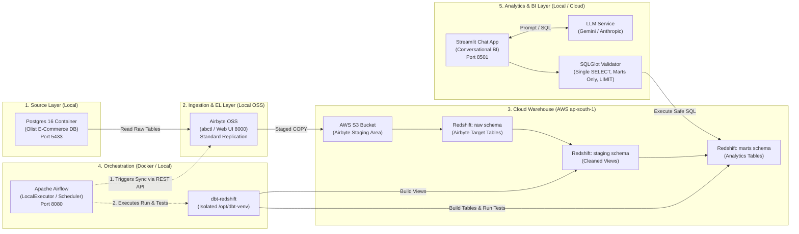

# Pipeline Architecture: End-to-End Data Engineering & Conversational BI

## Architecture Diagram

The diagram below illustrates the end-to-end data flow, execution boundaries, and orchestration mechanisms across all layers of the project.

---

## Component-by-Component Overview

### 1. Source System: Local PostgreSQL 16 (`olist-postgres`)
The source layer represents an operational transactional database (OLTP) hosting the real-world Brazilian E-Commerce public dataset (Olist). Running in a lightweight Docker container on host port `5433`, it stores six relational tables: `customers`, `orders`, `order_items`, `order_payments`, `products`, and `category_translation` (~100,000 orders). In a viva defense, this represents an external production system where direct analytics queries must never be run due to locking risks and unpredictable analytical query load.

### 2. Ingestion & Replication: Airbyte Open Source Software (OSS)
Airbyte functions as the modern Extract and Load (EL) data movement platform, orchestrated locally via `abctl` at `http://localhost:8000`. It connects to PostgreSQL using standard replication and synchronizes the raw operational tables into the data warehouse on a configurable schedule or manual trigger. By adopting Airbyte rather than writing brittle, custom Python ETL extraction scripts, the pipeline leverages automated schema detection, error retries, and high-performance bulk-loading protocols.

### 3. Staging Storage: Amazon Simple Storage Service (AWS S3)
Airbyte uses Amazon S3 as an intermediate staging buffer when copying bulk data into Amazon Redshift. High-throughput data ingestion in Redshift relies on the parallelized `COPY` command from an S3 bucket in the same region (`ap-south-1` Mumbai) rather than issuing thousands of slow individual SQL `INSERT` statements. Once loaded into Redshift, the staging objects can be managed via S3 lifecycle policies to prevent cloud storage costs.

### 4. Cloud Data Warehouse: Amazon Redshift Serverless
Amazon Redshift Serverless serves as the centralized Cloud Data Warehouse (OLAP), decoupled into compute (Workgroup) and storage (Namespace). We configure the lowest base capacity (Base RPUs) paired with an AWS usage cost guardrail to satisfy college project budget limits. Redshift separates data into three distinct logical schemas: `raw` (landing zone loaded exclusively by Airbyte), `staging` (lightweight views that clean and cast types), and `marts` (pre-aggregated dimensional business tables). To maintain cloud portability, all Redshift-specific configurations are confined to `profiles.yml` and documentation, enabling a drop-in replacement with Snowflake if required.

### 5. Transformation Engine: dbt (Data Build Tool - `dbt-redshift`)
dbt enforces modern software engineering best practices (version control, automated testing, documentation, and modularity) inside the data warehouse. Using SQL `SELECT` statements, dbt transforms unstructured or raw data into clean staging views, and compiles star-schema data marts (`mart_daily_sales`, `mart_top_products`, `mart_customer_summary`, `mart_delivery_performance`). Furthermore, dbt executes schema-level tests (`unique`, `not_null`, `relationships`, `accepted_values`) and custom singular business tests before any business user touches the data.

### 6. Pipeline Orchestrator: Apache Airflow (LocalExecutor)
Apache Airflow is the mission-critical orchestrator that coordinates dependencies across the distributed architecture. To respect the workstation's 16 GB memory ceiling (shared with Airbyte and Docker), Airflow runs in a lean Docker Compose configuration using `LocalExecutor` without heavy distributed components like Celery, Redis, or Flower. The DAG (`olist_daily_pipeline`) triggers the Airbyte sync via its authenticated REST API, polls for completion, invokes dbt runs and dbt tests inside a separate virtual environment (`/opt/dbt-venv`) to eliminate Python dependency collisions, and logs a comprehensive pipeline status summary.

### 7. Conversational BI Application: Streamlit + LLM + SQLGlot Validator
The presentation layer is a conversational Business Intelligence (BI) web application powered by Streamlit. Non-technical stakeholders enter business questions in plain English, which are converted to SQL queries via an LLM adapter supporting Google Gemini and Anthropic Claude. Crucially, before any generated SQL touches Redshift, it passes through a deterministic validator built with `sqlglot`. The validator enforces read-only access (single `SELECT` statement, restricted exclusively to the `marts` schema, no DML/DDL, forced `LIMIT 1000`, connecting via a dedicated `app_readonly` database role), preventing prompt injection or data leakage during live college demonstrations.
